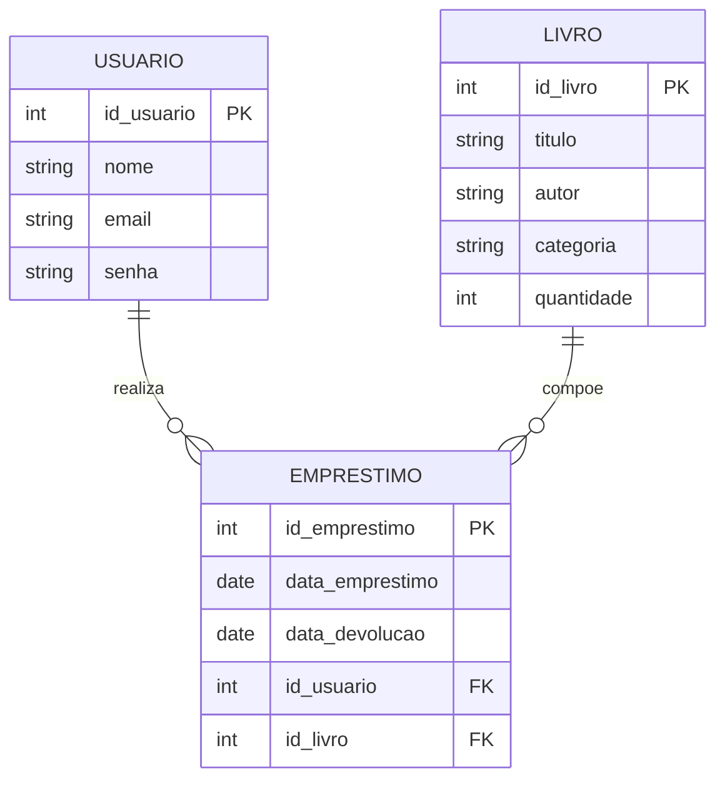

# Acervo Escolar — Sistema de Biblioteca Escolar

Sistema web completo para informatização e gestão de biblioteca escolar, com autenticação de usuários, controle de catálogo de livros, gestão transacional de empréstimos e devoluções, relatórios de circulação (incluindo ranking dos livros mais emprestados) e documentação técnica integrada.

- **Link do Site Publicado:** https://acervoescolar.ai.studio

---

## Visão Geral da Aplicação

- **Frontend:** React 19, TypeScript, Tailwind CSS v4, Lucide React
- **Backend:** Node.js, Express
- **Banco de Dados:** SQLite embarcado (`biblioteca.db`) com integridade referencial e script SQL compatível com PostgreSQL/MySQL em `database/biblioteca_escolar.sql`

### Execução do Projeto

```bash
# Instalar dependências
npm install

# Executar em ambiente de desenvolvimento (porta 3000)
npm run dev

# Gerar build de produção
npm run build
```

### Credenciais Iniciais de Acesso

| Nome | Perfil | E-mail | Senha |
| --- | --- | --- | --- |
| Ana Clara Mendes | Bibliotecária | `ana.mendes@escola.edu.br` | `biblioteca123` |
| Carlos Eduardo Silva | Professor | `carlos.silva@escola.edu.br` | `aluno123` |
| Mariana Oliveira | Aluna | `mariana.oliveira@escola.edu.br` | `aluno123` |

---

## Diagrama Entidade-Relacionamento (DER)



### Entidades e Atributos

- **Usuário (`1 : N` Empréstimo):** `id_usuario` (PK), `nome`, `email`, `senha`
- **Livro (`1 : N` Empréstimo):** `id_livro` (PK), `titulo`, `autor`, `categoria`, `quantidade`
- **Empréstimo:** `id_emprestimo` (PK), `data_emprestimo`, `data_devolucao`, `id_usuario` (FK), `id_livro` (FK)

---

## Descritivo de Casos de Teste de Software

| ID | Cenário | Pré-condição | Ação / Entrada | Resultado Esperado |
| --- | --- | --- | --- | --- |
| **CT01** | Login válido | Usuário cadastrado no banco (`ana.mendes@escola.edu.br`) | Informar e-mail e senha válidos e clicar em **Entrar** | Acesso liberado ao painel principal (`Visão Geral`) com exibição dos indicadores. |
| **CT02** | Login inválido | Tela de login aberta | Informar e-mail inexistente ou senha incorreta e clicar em **Entrar** | Acesso bloqueado e mensagem de erro exibida (`E-mail ou senha inválidos. Acesso negado.`). |
| **CT03** | Cadastro de livro | Usuário autenticado na aba **Livros** | Preencher Título, Autor, Categoria e Quantidade ($\ge 0$) e clicar em **Cadastrar livro** | Livro salvo no banco de dados e listado imediatamente no catálogo. |
| **CT04** | Empréstimo com estoque | Livro selecionado possui `quantidade >= 1` | Selecionar Usuário, Livro disponível e datas válidas; clicar em **Registrar empréstimo** | Empréstimo registrado com status `Em aberto` e quantidade do livro decrementada em 1. |
| **CT05** | Empréstimo sem estoque | Livro selecionado possui `quantidade = 0` (ex.: *Vidas Secas*) | Tentar registrar empréstimo para o livro esgotado | Operação bloqueada com alerta de estoque indisponível; estoque permanece em `0`. |
| **CT06** | Registro de devolução | Existe empréstimo com status `Em aberto` | Clicar em **Registrar devolução** na linha do empréstimo ativo | Status alterado para `Devolvido`, `data_devolucao` preenchida e estoque incrementado em 1. |
| **CT07** | Validação de quantidade negativa | Formulário de cadastro/edição de livros aberto | Informar quantidade menor que zero (ex.: `-1`) e tentar salvar | Operação impedida com mensagem exigindo valor inteiro maior ou igual a zero. |

---

## Lista de Requisitos de Infraestrutura

### Hardware

- **Processador:** Dual Core (2.0 GHz) ou superior
- **Memória RAM:** 4 GB ou superior
- **Armazenamento:** 20 GB disponíveis em disco

### Software

- **Navegador Web:** Google Chrome, Mozilla Firefox, Microsoft Edge ou Safari atualizados
- **Banco de Dados:** MySQL, PostgreSQL ou SQLite (script compatível disponível em `database/biblioteca_escolar.sql`)
- **Servidor Web / Aplicação:** Node.js (v20+) com Express para servir API e frontend

### Rede

- **Internet:** conexão para acesso remoto, implantação ou atualizações
- **Rede local da escola:** infraestrutura LAN / Wi-Fi para acesso simultâneo das estações da biblioteca e secretaria

---

## Estrutura de Arquivos Relacionados

- `server.ts` e `server/db.ts` — API REST em Express e persistência relacional SQLite
- `src/components/LoginView.tsx` — Tela de autenticação (`E-mail`, `Senha`, `Entrar`, `Limpar`)
- `src/components/DashboardView.tsx` — Painel principal com indicadores e movimentações recentes
- `src/components/BooksView.tsx` — Cadastro, alteração, exclusão e pesquisa de livros
- `src/components/LoansView.tsx` — Interface de gestão de empréstimos, devoluções e histórico
- `src/components/ReturnsView.tsx` — Página dedicada para controle e registro de devoluções de livros em movimento
- `src/components/ReportsView.tsx` — Relatórios detalhados (CSV) e ranking de livros mais emprestados
- `src/components/DocsView.tsx` — Documentação técnica interativa (RF, DER, SQL, Casos de Teste e Infraestrutura)
- `database/biblioteca_escolar.sql` — Script SQL de criação e população das tabelas `Usuario`, `Livro` e `Emprestimo`
- `docs/DOCUMENTACAO_TECNICA.md` — Especificação técnica em Markdown
